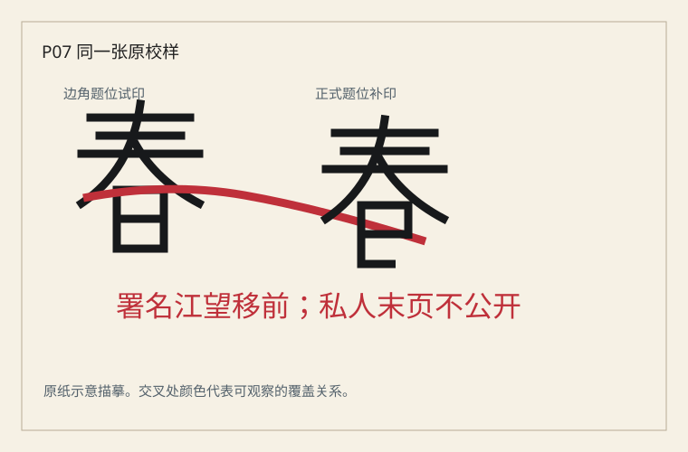
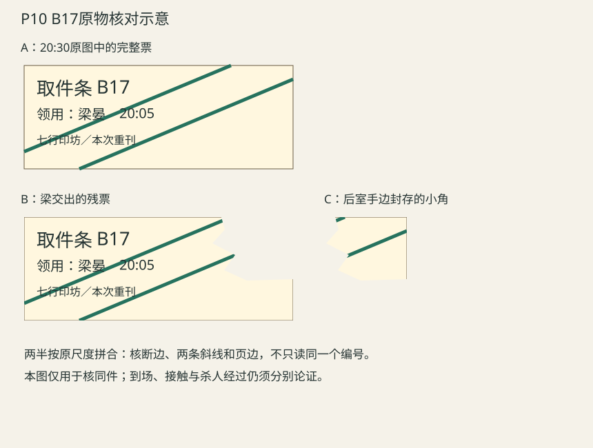

# 第七次校样 证据与查询材料

主持人分发源稿。P01—P17的标题与正文可给玩家，文后答复规则仅供主持人。均在开场可申请，不按幕扣住；目录完整公开。P08、P10的原物由警方封存，玩家拿副本与描摹；回传可尽早，结案前必须取得，不在最终讲解补决定性事实。

## P01 人与屋

在铺名单：孟青、沈舟、陆芹、韩照、林祈、许柚；旧主编顾砚生；发行协调梁晏、发行商冯煜、顾砚生儿子顾霁；医生罗师傅与一名快递员。作者江望在外城。没有未登记访客。

后室只有一扇通向短走廊的门，走廊经唯一后区入口连接前厅。侧间字盒柜与装订台都在前区，不必经过后区入口。没有暗门、藏人或可替机器操纵的攻击装置。前厅压机只用于印刷，停止时没有自主动作。

时钟已经核对一致。所有原始记录上的钟点都是真实钟点，不设钟差。

## P02 真的全体不在场

20:32—20:45，六名玩家和梁晏、冯煜、顾霁九名发布参与者均在前厅两机位原片中，脸与位置持续可辨认，没有离席。罗师傅也在前厅镜头内照看韩照。

画面实时，无剪辑、延迟或替身。压机在镜头范围内，孟青20:33的操作属于这段原片。快递员在装卸区，另有前门与装卸区工作记录相互核对，没有进入后室。

这份记录只证明20:32之后，不证明20:30之前或开播前两分钟。

## P03 一枚字的两个状态

20:28，孟青用一枚大标题铅字“春”，在试纸左边角印下题位样。许柚见过移交沈舟的纸，另留一张完整字试纸。

20:32，孟搬字时右下笔划崩缺，许与直播镜头都看见断角。他保留字与断角。此后同枚字只能留下缺右下笔的印面，不会自行恢复。

大字只有这一枚，同一大小、同一边缘细节。普通小号字与复印件可分辨，不能当作同一原印。纸能多次过机，但后一次不会擦掉已有黑笔画。两次“春”印在不同位置。

## P04 沈舟确实见到活人

沈舟可立即确认：孟最后一次把边角题位试纸交来后，他拿它进后室。顾砚生当着他用红笔写了“署名江望移前；私人末页不公开”，同时画了一条跨过边角题字和右侧预留题位的长线。

顾能与他正常交谈、取笔、交回原纸。不是沈隔门听到声音，不是替别人转述。沈没有看钟，不能给这个会面报精确分钟。

之后沈回前厅签收原稿袋。顾落笔发生在签收之前。签收的同时，顾从走廊来到前厅入口边，亲手交来补充授权页，回答沈关于末页的具体问题，再返回后区；P17记录了这段正常交接。此时的顾已不是20:22推搡现场那个倒地姿势。

## P05 补印者可以直接说

孟青说：“20:33我在右侧正式题位补印，左边角的完整字不用再打。我取过来的这张纸已经有红批。补印时字已经缺角，直播里能看见我操作。”

他没有看见顾写红字，不知道那次会面的钟点。可以当场配合检查、重演纸张过机顺序，专业操作不用玩家做。

## P06 二十点三十分的签收

快递原单R04：20:30，江望寄来的原稿袋交沈舟本人，扫码记录、签收与快递员见闻相符。没有代签或补填钟点。

沈自己记得：见顾亲批在前，回前厅签袋在后。快递员不证明沈此前在哪里，也不证明袋中每页内容。

## P07 同一张原校样

这是真实同一纸张的观察描摹，非拼接页、假签名或复印替换。左边角完整字、右正式题位断字大小一致，来自同一枚字的两次印刷。

放大交叉点的可见关系：**左边黑墨被红线压住；右边黑墨压住红线。**图中红线与红批是同次落笔，笔路连贯。此观察可靠，不需要玩家判断现实油墨化学或干燥速度。

可领取甲、乙、丙三片，按能形成这个交叉关系的顺序摆放。纸层只证明相对先后；给活人会面定范围，还须结合P04、P06。

## P08 现场与初检

许柚20:45发现顾倒在后室校对桌旁。警方封存现场，不要求玩家搬动遗体、演出攻击。

罗师傅与到场人员记录的给定专业观察：致死伤为颈部带状压迫，现场棉装订带与该伤相合；额头较早的表浅擦伤不是死因。正式后续由警方完成，故事不要求玩家猜病理或死亡精确分钟。

死者手边、校对桌内侧发现B17取件条撕下的一小角。装订带是印坊公共材料，人人可能接触，不能仅凭拿过带子指认个人。

## P09 早些时候的推搡

陆芹的直接见闻：20:22顾夺她带来的原稿，抓住手腕。韩照推开顾，顾额头磕到桌边；随之纸架倾倒，韩被撞伤。20:24她带韩出，顾自己站起骂人。她到前厅立即联系医生。

韩20:22—20:26局部记忆空白，有实际撞伤与照看记录。20:26以后记忆连续。他可以问陆发生过什么；这不是必须等到最后一幕才准讲的事实。

伤害、愤怒与责任应分别查，不凭谁有空白就认定谁杀人，也不凭后来有人见顾活着便单独判定先前所有行为无害。

## P10 B17的两半

领用登记：20:05，梁晏本人领B17取件条，用于本次重刊运输核对。B17为唯一流水号，票上有斜向印线与骑缝小标，不只靠颜色认件。

20:30，沈签收R04时拍过装卸地址板留档，画面边缘含梁拿在手里的完整B17；原图钟点与R04相互核对。20:32开播时，原片可见梁将残缺的同张票塞回胸前口袋。这只是可见原物状态，不是对杀人的录像。

小角由警方在后室死者手边取得；较大的残票由梁在原物核对时交出，均记录封存来源。两半断边与斜印线、骑缝标连续拼合，图示可以自己拼。它证明梁的随身物与后室发生了接触，接触的经过仍须与案发窗口、见闻和其他材料一起解释。

## P11 梁的两次说法

首次被问开播前做什么，梁说：“20:30以后我就在前厅等开播，没再进后室。我只拿过最后校样。”这是他的陈述，非旁白事实。

沈可确认自己20:30签袋之后，留在前厅，从入口旁看见梁往后室方向走；他没有看见屋内攻击。完整B17与开播时残票的状态也可核对。

对出P10后，梁改称：“我进去争了两句，他扯了我的票；我走时他还好好的。”此句也需核验，不因他承认进屋就自动等于承认杀人。之后他要求由警方继续问，不让玩家逼供。

## P12 每个人的片段

20:28—20:32期间：

- 孟在字盒柜与前厅间取工具，许见他把试纸交沈，不能替每一秒担保。
- 沈先到后室，再回前厅签R04，随后取作者授权；亲眼见顾正常交谈，也见梁向后室走。
- 陆、韩、医生在前厅照看伤情，陆中间去侧间取过水。医生提供实际看见的片段，不把普通照看吹成全程监控。
- 林在前厅与侧间核旧工作记录，能出示取出的文件与顺序。
- 许在装订台核私人页授权、看交来的纸，20:32回前厅开播。
- 冯在装卸口核箱，顾霁在前门打电话；这些来源不能未经核对就延长成不在场证明。

以上都是查证入口，不能因为角色互相信任，就把所有未见片段写成已经证实。只有P02覆盖开播后的全体。

## P13 两个需要归还的名字

江望的原作稿、早期寄件副本与旧试印能相互对出：《春天借住在四楼》的图文原作出自江望，不是他偷顾砚生的作品。旧刊长期署顾名，需要更正。

另有当年材料交还登记与未被采用的原说明：梁炳并未偷走排印资料，顾知道是自己同意借出后又要找人担责。登记、顾的原始业务备忘与经手人江望可分别核对，不能仅凭梁儿子的一句控诉下结论。

顾今晚的工作便笺：“署名按江望改，梁炳那行不动，旧事不再展开。”梁承认来要求顾也撤回对父亲的指控。这解释争执，不替他任何暴力免除责任。

可以同时查谋杀、还江望署名、还梁炳清白；不能因为梁晏涉嫌杀人，就继续把他父亲写成贼。

## P14 旧刊与六次确认

原作被改署名后，旧刊的公开版本缺少江望原来写给女儿的称呼，把私人语句当成顾的励志随笔。六人当年各有保留、误判或顺从，不是全知。

本晚六份真签条分别只确认各自页的排字、图稿或装订检查。没有一张授权他人替江望决定署名、替陆芹公开家信，也没有一张保证此后所有版本都相同。

林祈保留的旧记录曾把“建议作者匿名”写成“作者接受”；这份未经确认的记录需要由林自己更正。它不能因为今晚做好事就被销毁或宣布误会。

## P15 作者与收件人的意愿

江望的可直接核对授权：愿意以本名重刊公开图文，要求署名在作品前面；私人末页原是寄给女儿，不随公开重刊自动发表。若想公开，须作者和收件人各自同意，任一人暂不决定就先另封。

陆芹、许柚拆页与裁开旧刊有此授权。直接问即可解释，不能把她们写成怕被误会却硬不肯说的人。

江望愿意接受电话，他能说起作品、寄宿学校、四楼和女儿，但没亲历今晚后室。他不是拿一通电话就能补齐谋杀证据的全知证人。

## P16 发出去的是什么

一百二十册旧版，装成三箱，每箱四十。出版物仍署顾名，末页里有未经此次明确同意继续公开的私人文字。21:10预约快递尚可冻结；打电话可立即获得停止发车与暂存回执，无隐藏失败条件。

已有预览电子版寄给三个渠道：门店展示、读者群管理员、地方刊物编辑。可以分别发勘误与正确文件，不要求先判定杀人者；也可暂时只告知“署名与末页需复核，先停转发”，不替作者抢作最终声明。

停掉运输不是完成重刊。还需确认署名、哪些页替换、私人页怎样保存、旧声明如何撤回。纸本、电子更正、勘误贴条都有效，不因不用老压机而失去成果。

## P17 开播前的入口预录

一号机按原定发布流程，从20:30开始预录，镜头只覆盖前厅通向后区的唯一入口和长桌一角，不是全屋监控。文件与20:32起的原片连续，钟点真实。这个预录入口从开场就在材料目录里，可立即检查。

开头同步拍到沈签R04，以及顾从走廊来到入口边亲手交还补充授权页。沈问“私人末页还是另放？”顾当面答“别跟公开版一起发”。人物、声音和动作可核，是顾活着的直接端点，不是仅凭一张纸推定。

随后顾回后区。从此端点直到20:32，入口连续可见：只有梁晏进入后区，随后也只有梁出来。其余人没有从这里进入或出来。后区无另一通路；32后所有已列人员都在前厅或已核的装卸口，不能再假设另有人藏在后区。

本记录不拍后室内攻击，须与P08的致死伤、P10现场物、P11说法变化和动机共同解释。不把顾在30又露面，误读成“最终校样的批注发生在30之后”。

## 主持人答复 这部分不发玩家

**梁**：可直接承认父亲被诬、自己恨顾；先给P11原始说法，证据对出后改口。关于校样，他说“顾已经批了最终校样，我们开播后都在这里”，不要由旁白给他盖真章。他的谎话可以被立即纠正。不要续编隐藏人、神奇工具或新不在场。

**冯**：关心货与成本，答“先停可以，重发哪版你们和作者确认”。可以烦躁但不能为了推动剧情拒接合理电话。核前门记录就给，普通争执不是犯罪证据。

**顾霁**：最初想保父亲名誉，出示原件后可承认“不替他否认这些”。能协助找原稿，不被强迫立即谴责父亲或原谅梁。他没看见杀人，不新增关键目击。

**江望**：讲作品与女儿，知道旧事只答自己亲历。直接问书为谁写就回答，不以难言苦衷吊胃口。可以解释“我那时想先让她有一本认路的书，后来才知道署在谁名下不能随别人”。不会突然原谅顾。

**医生/警方**：给已有专业观察和记录，核玩家明确提出的问题；未知答待查，不等于没有。正式法律结论由后续处理，但主持人在复盘可据已给材料确认故事真相，不再添加新认罪书。
