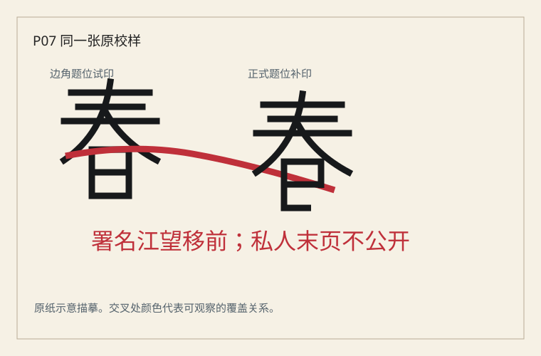

# 第七次校样 三分钟核心样段

这是可直接摆在桌上的谜面，不是试玩实录。不含真凶身份。故事发生在仍保留手工排印的七行印坊。六名玩家来追讨一份作品的署名，却遇上一桩命案。

## 先摆六张事实卡

1. 顾砚生20:45被发现遇害。警方初步观察确认颈部带状压迫为致死伤，额头另有较早的表浅擦伤；不要求玩家猜医学或精确死亡分钟。
2. 从20:32到20:45，六名玩家与梁、冯、顾霁九名发布参与者及医生，一直共同出现在前厅两机位的校刊发布原片里；快递员在已核的装卸口记录中，没有进后室。时间真实、没有离席、没有剪辑。人不在后室，机器也没有杀人功能。
3. 20:28，题签用的大铅字“春”完整，留下试纸。20:32这枚字崩掉一角，有两名见证者和实物；之后该字只能印出右下缺笔。同字两次印在纸的不同位置，不会用叠印把原有黑笔画擦掉。
4. 一张后来归为“最终校样”的原纸，带着顾亲手写的红批注，也带着断笔“春”。没有冒签、没有复印替换。沈舟亲眼见过顾落笔，但当时没看钟。
5. 沈舟20:30回到前厅签收一个原稿袋，记录可查；他见顾落笔发生在那之前。不要把作者知道的20:29交给玩家。
6. 补印在前厅，20:33孟青操作入镜。正常工作流程允许同张试纸过机多次。直接问孟，他会说明“先有红批，再补正式题位”；这条证词不被扣住。

## 给玩家看的原纸

图中是为看清交叉处制作的原物描摹：左边完整字的黑线被红线覆盖，右边断字的黑线覆盖红线。观察可靠，无需专业油墨鉴定。红批注与红线属同一次落笔，四边连贯。

有人提出一个**待核推论**：“最终校样有20:32后才会有的字，顾又亲手批过它，所以他那时还活着。可那之后我们全都不在后室——谁还能杀他？”

主持人只问：“这个推论哪一步需要检查？把三张透明片排一排，再把纸上亲批会面的时段写成区间。”

不要求玩家先相信错误推论。直接否定、向孟或沈提问、检查图，都可以。

## 主持人答案 单独阅读

左边完整黑字→红批注→右边断字补印。断字给的是第二次印刷时间，不是批注时间。结合20:28的完整字试印与沈20:30回前厅的直接记录，顾亲手批字在20:28—20:30之间。

20:32后的全体不在场证明仍是真的，查案要回到此前的时段，不能把已证实的录像宣布为假。纸、签名和铅字都不撤回，撤回的是“手写一定晚于纸上最后一次印刷”的推断。

问孟可以迅速得到正确顺序，这是正当快解。无需为制造谜感把补印者写得不肯说或看不见红字。核心样段只验证这个结构，不证明真凶是谁、不证明整桌时长，也不宣称所有玩家必然会受骗。
